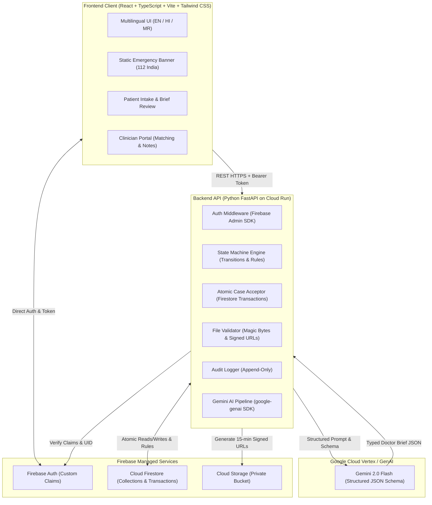
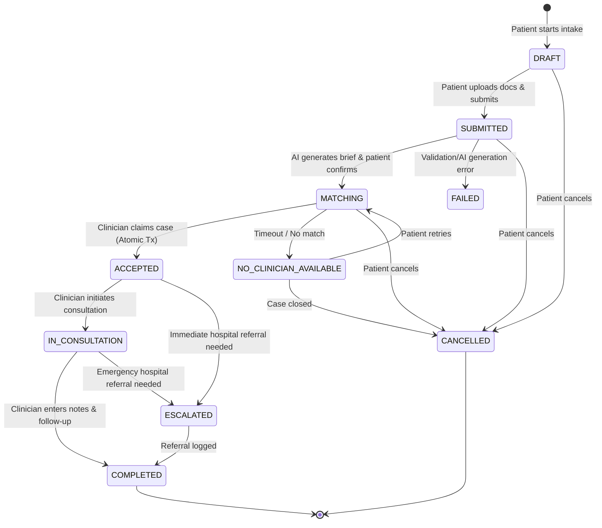

# MedBridge AI — Architecture Specification, System Design & MVP Blueprint
**Document Version:** 1.1.0  
**Target Milestone:** Hackathon MVP  
**Platform Category:** AI-Powered Urgent Healthcare Coordination Platform (Care Coordination Only)

---

## 1. Golden Workflow (In Simple Language)

Imagine a patient named Ramesh in a semi-urban town who suddenly develops severe fever and acute stomach pain late in the evening:

1. **Sign-In & Language Selection:** Ramesh visits MedBridge AI on his phone, picks **Hindi (हिन्दी)** as his language, and logs in using Firebase Auth.
2. **Urgent Request & Instant Safety Guardrail:** Ramesh selects his requested urgency as **"Urgent"**. Instantly, without waiting for the server or any AI, a bright static emergency warning appears on his screen: *"If you or someone nearby is experiencing chest pain, breathing difficulty, or severe trauma, call 112 immediately or go to the nearest emergency center."*
3. **Structured Intake & Document Upload:** Ramesh describes his symptoms (fever for 2 days, sharp pain in lower right abdomen) and uploads a synthetic blood test report (PDF). The system validates the file's extension, MIME type, and magic bytes (`%PDF-`), uploading it to a private Cloud Storage bucket.
4. **AI Doctor Brief Synthesis:** On the backend, Google Gemini reads Ramesh's description and extracts facts from the uploaded report. It compiles a structured **Doctor Brief**:
   - **Patient-Reported Facts:** Symptoms, timeline, known conditions.
   - **Document-Extracted Facts:** Lab values with exact units preserved (e.g., *WBC: 14,200 /µL, Source: Page 1*).
   - **Unknowns:** Parameters not provided (e.g., *Fasting status: Unknown*).
   - **Clarification Questions:** Questions the doctor should ask.
5. **Patient Review Gate:** Ramesh reviews the generated brief on his phone, confirms or edits the patient-reported fields, and submits it to the care matching queue.
6. **Clinician Matching & Atomic Acceptance:** A licensed emergency physician, Dr. Patil (visibly marked `[DEMO / SIMULATED]`), sees the case in the matching pool. Dr. Patil clicks "Accept Case". A Firestore transaction ensures that even if another doctor clicked at the same instant, only Dr. Patil claims the case (the second doctor gets an HTTP 409 Conflict).
7. **Human Consultation & Follow-Up Plan:** Dr. Patil reviews the brief and original PDF report via a short-lived 15-minute signed URL. Dr. Patil provides text-based clinical advice and records a mandatory follow-up task (e.g., *"Schedule physical abdominal ultrasound if pain persists beyond 6 hours"*).
8. **Completion & Patient View:** Ramesh sees the completed case, Dr. Patil's consultation notes, and his scheduled follow-up care instructions in Hindi.

---

## 2. Prioritized MVP Feature List (MoSCoW Framework)

### MUST HAVE (Core Hackathon MVP)
- **Non-Negotiable Static Emergency Guidance:** Instant, client-side, zero-network emergency instructions (Call 112 / Nearest Hospital) displayed whenever "Urgent" or "Emergency" is selected.
- **Multilingual Support:** Native language selection for English, Hindi (हिन्दी), and Marathi (मराठी) across all patient intake and status views.
- **Role-Based Access Control:** Separate patient, clinician, and admin views with server-side validation via Firebase Custom Claims & Admin SDK.
- **Idempotent Case Intake:** Intake form accepting chief complaint, duration, urgency, and an idempotency key to prevent duplicate case creation on network retries.
- **Secure File Upload Validation:** Server-side extension, MIME, and magic-byte checks (`%PDF-`, JPEG, PNG) up to 10MB, served via private storage and 15-minute signed URLs.
- **Gemini Structured Doctor Brief:** Server-side `google-genai` integration returning strictly typed JSON validated against Pydantic schemas, separating patient claims from document facts and preserving units.
- **Human-in-the-Loop Review Gates:** Patient review gate (confirm/edit) and clinician review gate before brief finalization.
- **Concurrency-Safe Case Claiming:** Firestore atomic transaction ensuring a case can only be accepted by one clinician, returning HTTP 409 Conflict upon race collisions.
- **Text-Based Consultation & Follow-Up:** Clinician consultation notes and structured follow-up instructions with date and status.
- **Immutable Audit Logging:** Append-only logging of all case creations, brief generation, clinician claiming, document access, and authorization failures.
- **Explicit Simulation Labelling:** Every simulated clinician, availability status, and consultation clearly stamped `[DEMO / SIMULATED]`.

### SHOULD HAVE (High Priority MVP Enhancements)
- **Local Firebase Emulator Support:** Full local testing for Auth, Firestore, and Storage with zero cloud cost and zero credential exposure.
- **Network-Resilient UX:** Offline indicators, retry buttons on upload failures, and loading states for rural/low-bandwidth users.
- **Clinician Specialty Filtering:** Matching queue filtering based on specialty (e.g., Emergency Medicine vs. Pediatrics) and spoken languages.

### OPTIONAL / POST-MVP (Only After Core Flow is Proven)
- **Cloud Speech-to-Text:** Voice input for vernacular intake in Hindi and Marathi.
- **Firebase Cloud Messaging (FCM):** Push notifications for matching and consultation updates.
- **Live WebRTC Video Consultations:** Upgrading text-based consultations to live audio/video calls.

---

## 3. End-to-End Architecture Diagrams (Mermaid)

### 3.1 High-Level Component Topology


### 3.2 State Machine Transition Flow


---

## 4. Complete Workspace Folder Structure

```
c:\Medflow\
├── docs\
│   └── ARCHITECTURE.md            # System architecture, data contracts & roadmap (this file)
├── firebase\
│   ├── firestore.rules            # Deny-by-default security rules
│   ├── firestore.indexes.json      # Composite index definitions
│   ├── storage.rules              # Private bucket zero-access rules
│   └── seed_data.json             # Demo clinician profiles with [DEMO / SIMULATED] tags
├── backend\
│   ├── app\
│   │   ├── __init__.py            # Python 3.10.0 ForwardRef compatibility shim
│   │   ├── main.py                # FastAPI app, CORS, middleware, router mount
│   │   ├── core\
│   │   │   ├── config.py          # Pydantic SettingsConfigDict configuration
│   │   │   └── state_machine.py   # State enum, transition validator & exceptions
│   │   ├── schemas\
│   │   │   ├── __init__.py        # Exported Pydantic schemas
│   │   │   ├── user.py            # UserRole, UserProfile schemas
│   │   │   ├── patient.py         # PatientProfile, EmergencyContact schemas
│   │   │   ├── clinician.py       # ClinicianProfile, Specialty, Availability schemas
│   │   │   ├── case.py            # CaseCreate, CaseResponse, Urgency schemas
│   │   │   ├── document.py        # Magic bytes validator, UploadIntent schemas
│   │   │   ├── doctor_brief.py    # Strict DoctorBrief JSON schema & review models
│   │   │   ├── consultation.py    # Consultation, FollowUp schemas
│   │   │   └── audit.py           # AuditEvent, EventType schemas
│   │   ├── services\
│   │   │   ├── case_service.py    # Case business logic, atomic locking, transitions
│   │   │   └── audit_service.py   # Append-only audit trail logging
│   │   └── api\
│   │       ├── api_v1.py          # Router aggregator
│   │       └── routers\
│   │           ├── health.py      # Health check & emulator telemetry
│   │           ├── cases.py       # Case CRUD, submit, matching, accept endpoints
│   │           ├── documents.py   # Upload intent & magic bytes verification
│   │           └── audit.py       # Audit log query endpoints
│   ├── tests\
│   │   └── test_case_flow.py      # Automated pytest suite (concurrency, state machine, magic bytes)
│   ├── pytest.ini                 # Pytest configuration
│   ├── requirements.txt           # Python dependencies
│   ├── .env.example               # Backend environment template
│   └── .env                       # Local environment configuration (gitignored)
├── frontend\
│   ├── index.html                 # Mobile-first HTML entrypoint with Inter font
│   ├── package.json               # React, TypeScript, Tailwind CSS, Lucide icons
│   ├── vite.config.ts             # Vite configuration
│   ├── tsconfig.json              # TypeScript configuration
│   ├── tailwind.config.js         # Medical theme tokens (teals, ambers, roses)
│   ├── postcss.config.js          # PostCSS configuration
│   ├── src\
│   │   ├── main.tsx               # React DOM entrypoint
│   │   ├── App.tsx                # Main container, urgency selector & form
│   │   ├── index.css              # Tailwind base directives
│   │   ├── types\
│   │   │   └── index.ts           # Frontend TypeScript domain interfaces
│   │   ├── i18n\
│   │   │   └── translations.ts    # Multilingual dictionary (English, Hindi, Marathi)
│   │   └── components\
│   │       ├── common\
│   │       │   ├── Header.tsx     # Header with logo, language selector, role switcher
│   │       │   ├── EmergencyBanner.tsx # Zero-network static 112 emergency guidance
│   │       │   └── SimulationBadge.tsx # [DEMO / SIMULATED] indicator tag
│   │       └── dashboard\         # Patient and Clinician dashboard cards
│   ├── .env.example               # Frontend environment template
│   └── .env                       # Frontend environment configuration (gitignored)
├── firebase.json                  # Firebase Emulator Suite & Hosting configuration
├── PROJECT_STATUS.md              # Project status tracker, phases, env vars
└── .gitignore                     # Gitignore preventing secret or artifact leaks
```

---

## 5. Accounts, Tools & Environment Variables Setup Checklist

### 5.1 Accounts to Set Up
| Account / Service | Purpose | Action Required by User |
|---|---|---|
| **Google Cloud Account** | GCP Project hosting Cloud Run & Secret Manager | Free tier / educational GCP billing account |
| **Firebase Console** | Project creating Auth, Firestore, and Storage | Add Firebase to GCP project at [console.firebase.google.com](https://console.firebase.google.com) |
| **Google AI Studio** | Gemini API Key for Doctor Brief generation | Generate API key at [aistudio.google.com](https://aistudio.google.com) |

### 5.2 Local Tools & SDKs
| Tool | Required Version | Status in Workspace |
|---|---|---|
| **Python** | 3.10+ | Installed (`Python 3.10.0` at `backend/.venv`) |
| **Node.js** | 20+ LTS | Installed (`Node.js v20.18.0 LTS` in user directory) |
| **npm** | 10+ | Installed (`10.8.2`) |
| **gcloud CLI** | Latest | Optional for emulator dev; required for Cloud Run deploy |
| **Firebase CLI** | Latest (`npx -y firebase-tools`) | Configured via `npx` / `firebase.json` |
| **Java JRE** | Java 11+ | Optional (required only if running Java-based Firebase Emulator daemon) |

### 5.3 Environment Variables Reference
#### Backend (`backend/.env`):
```env
ENVIRONMENT=development
PORT=8000
GEMINI_API_KEY=<your-google-ai-studio-api-key>
GEMINI_MODEL=gemini-2.0-flash
FIREBASE_PROJECT_ID=demo-medbridge
FIRESTORE_EMULATOR_HOST=127.0.0.1:8080
FIREBASE_AUTH_EMULATOR_HOST=127.0.0.1:9099
FIREBASE_STORAGE_EMULATOR_HOST=127.0.0.1:9199
STORAGE_BUCKET_NAME=medbridge-ai-documents
```

#### Frontend (`frontend/.env`):
```env
VITE_API_BASE_URL=http://localhost:8000/api/v1
VITE_USE_EMULATORS=true
VITE_FIREBASE_API_KEY=demo-api-key
VITE_FIREBASE_AUTH_DOMAIN=demo-medbridge.firebaseapp.com
VITE_FIREBASE_PROJECT_ID=demo-medbridge
VITE_FIREBASE_STORAGE_BUCKET=demo-medbridge.appspot.com
```

---

## 6. Implementation Phase Checklist

- [x] **Phase 1: Architecture, Data Modeling, Tooling & Safety Blueprint**
  - Golden workflow, MoSCoW MVP feature breakdown, Mermaid diagrams.
  - Folder structure, tools/accounts list, risk matrix, and acceptance tests.
- [ ] **Phase 2: Authentication, Role-Based Access Control & User Profiles**
  - Firebase Auth integration (Email/Password & Google Sign-in).
  - Server-side role verification middleware (Firebase Admin SDK & Custom Claims).
  - Patient and Clinician profile registration in Firestore.
- [ ] **Phase 3: Case Intake, Emergency Guardrails & Secure Document Upload**
  - Intake form with Idempotency Key protection.
  - Zero-network static 112 emergency banner activation.
  - Cloud Storage upload intent, magic-byte validator (`%PDF-`, JPG, PNG), and 15-min signed URLs.
- [ ] **Phase 4: Gemini-Powered Doctor Brief Generation & Review Gates**
  - Server-side `google-genai` integration with strict Pydantic JSON schema.
  - Segregation of patient reports from extracted facts; explicit unknowns; unit fidelity.
  - Interactive Patient Review (confirm/edit) and Clinician Review gates.
- [ ] **Phase 5: Clinician Matching Pool, Atomic Concurrency Claiming & Consultation**
  - Matching queue filtered by specialty and language.
  - Concurrency-safe Firestore transaction for case acceptance (HTTP 409 on collisions).
  - Text-based consultation interface (`[DEMO / SIMULATED]`) and notes recorder.
- [ ] **Phase 6: Follow-Up Coordination, Multilingual Verification & Golden Demo**
  - Structured follow-up scheduling with dates and patient care instructions.
  - Full end-to-end verification across English, Hindi, and Marathi.
  - Deployment configuration for Cloud Run and Firebase Hosting.

---

## 7. Risks and Mitigations Matrix

| Risk | Impact | Likelihood | Mitigation Strategy |
|---|---|---|---|
| **AI Hallucination in Clinical Brief** | Critical | Medium | Strict Pydantic JSON schema; mandatory separation of patient-reported vs document-extracted facts; explicit "unknown" labels; mandatory patient and clinician review gates before brief is final. |
| **Patient mistaking coordination for emergency treatment** | Critical | Medium | Non-negotiable static emergency banner (Call 112 / Hospital) renders client-side with zero network/AI dependency whenever Urgent or Emergency is selected. |
| **Race condition where two clinicians accept the same case** | High | High | Atomic Firestore transaction that re-reads status == `MATCHING`, assigns clinician, and transitions to `ACCEPTED`. Second clinician gets an immediate HTTP 409 Conflict. |
| **Duplicate submissions on slow connections** | Medium | High | Mandatory `Idempotency-Key` header generated on client; backend returns existing case if key was already processed. |
| **Malicious or executable file uploads** | High | Low | Private bucket with zero public access; triple validation: file extension, MIME type, and binary magic bytes (`%PDF-`, JPEG, PNG); 10MB limit; 15-min signed URLs. |
| **Secret or API Key Leakage** | High | Low | `.env` files gitignored; zero secrets in client code; Secret Manager in production; local Firebase emulators for development. |
| **Low-bandwidth / rural connection dropouts** | Medium | High | Lightweight mobile-first bundle; static assets cached; multilingual strings loaded locally without external API latency. |

---

## 8. Acceptance Tests (Golden Demo Validation)

1. **Safety Acceptance Test:** Selecting "Emergency" or "Urgent" displays the 112 emergency banner within 50ms, functioning even in offline/airplane mode.
2. **Idempotency Acceptance Test:** Submitting the exact same case payload with the same idempotency key twice creates only 1 case record and returns HTTP 201/200 without duplication.
3. **Magic-Byte Rejection Test:** Renaming an executable or `.txt` file to `.pdf` and attempting an upload triggers an immediate HTTP 400 rejection stating magic byte validation failed.
4. **AI Brief Schema Acceptance Test:** Generated brief strictly conforms to `DoctorBriefSchema`, contains patient-reported facts, document-extracted facts with units, explicit unknowns list, and does not prescribe medications.
5. **Concurrency Collision Test:** Two simultaneous POST requests to `/cases/{id}/accept` result in exactly one HTTP 200 response and one HTTP 409 Conflict response.
6. **Signed URL Authorization Test:** Requesting a document download signed URL as an unauthenticated or unrelated user returns HTTP 403 Forbidden.
7. **Simulation Stamping Test:** 100% of demo doctor cards, consultation notes, and availability indicators render the `[DEMO / SIMULATED]` badge.

---

## 9. Document Access Security & Storage Architecture

### 9.1 Deliberate 403 vs 404 HTTP Status Code Decision
When an authenticated user requests document metadata, download URLs, or streaming access:
- **HTTP 404 Not Found**: Returned strictly when the requested `caseId` or `documentId` does not exist in Firestore.
- **HTTP 403 Forbidden**: Returned deliberately when the resource exists, but the caller fails Role-Based Access Control (RBAC) authorization checks:
  1. Patient requesting documents of a case that does not belong to their `patientId`.
  2. Unassigned clinician attempting to access an active or completed case.
  3. Unverified clinician (license unvalidated) attempting access.
  4. Assigned clinician attempting access when the case is in `CANCELLED`, `DRAFT`, `SUBMITTED`, `MATCHING`, or reassigned states (only `ACCEPTED`, `IN_CONSULTATION`, and `COMPLETED` permitted).

**Rationale**:
In a clinical care navigation platform, masking non-ownership with 404 causes critical clinical friction and diagnostics confusion (e.g. clinicians believing lab results disappeared from the system). Returning **403 Forbidden** provides unambiguous authorization feedback, adheres to healthcare audit compliance requirements by triggering immediate `DOC_VIEW_DENIED` immutable audit log entries, and permits proactive detection of privilege escalation attempts without leaking confidential document binaries.

### 9.2 Development & Local Emulator Streaming Fallback
Firebase Storage Local Emulators lack GCP private keys and the IAM Credentials API, preventing standard `generate_signed_url(version="v4")` execution.
- **Development / Emulator Architecture**: The backend provides a short-lived (5-minute / 300s) HMAC-SHA256 streaming fallback endpoint (`GET /api/v1/cases/{caseId}/documents/{docId}/stream?token=...&expires=...&userId=...`).
- **Cryptographic Binding**: The token binds `caseId + documentId + userId + expiry` using a secret from the environment (`DOC_STREAM_SECRET`, required at startup outside `TESTING`).
- **Verification**: Evaluated with `hmac.compare_digest` in constant time. Swapped document IDs and expired timestamps are rejected with HTTP 403.
- **Stream Headers**:
  - `X-Content-Type-Options: nosniff` (prevents MIME sniffing).
  - `Cache-Control: no-store` (prevents intermediate and browser caching of PHI).
  - `Content-Disposition`: Sanitized filename, rendered `inline` for PDFs (`application/pdf`) and `attachment` for images (`image/jpeg`, `image/png`).
- **Security Guardrail**: Stream tokens and URLs containing tokens are **strictly never logged** in application logs or audit event details.

### 9.3 Phase 12 Production Cloud Storage Signing Architecture [UNTESTED]
In production Cloud Run environments, service-account key files (`.json`) are **strictly prohibited** to prevent credential leakage.
- **Service Account Identity**: The Cloud Run backend runs under the compute service account `medbridge-backend@<project-id>.iam.gserviceaccount.com` assigned `roles/iam.serviceAccountTokenCreator` and `roles/storage.objectViewer`.
- **IAM signBlob Integration**: The Google Cloud Storage client delegates signing to the Google Cloud IAM Credentials API `signBlob` endpoint (`https://iamcredentials.googleapis.com/v1/projects/-/serviceAccounts/{email}:signBlob`) via Application Default Credentials (ADC).
- **Zero Local Keys**: Eliminates long-lived private key files from disk and container images.
- **Status**: **`[UNTESTED - PHASE 12]`** (Scheduled for verification during production Cloud Run infrastructure rollout).

